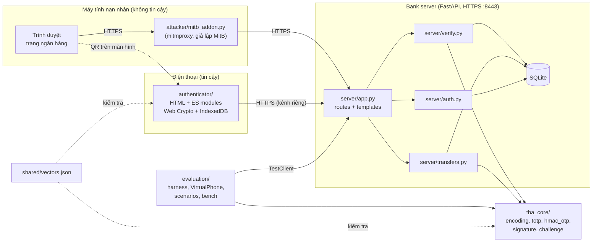
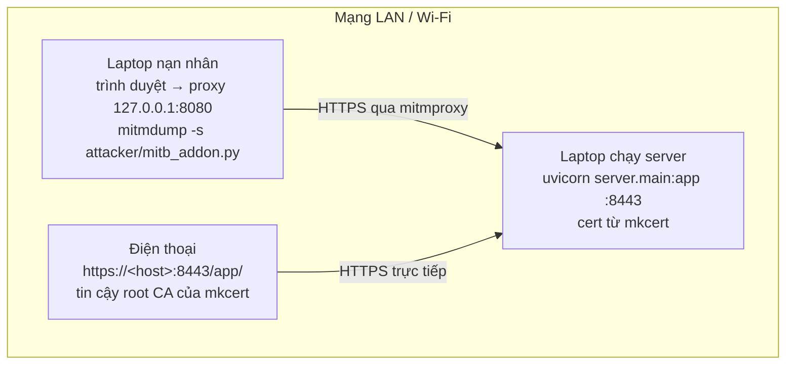
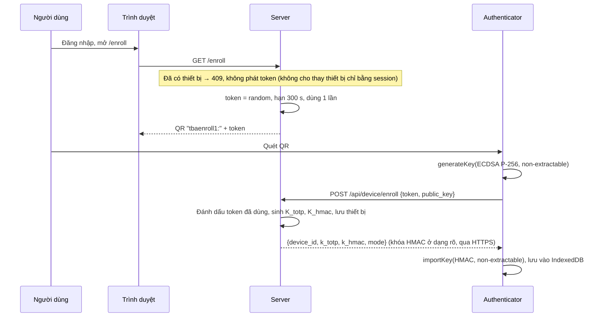
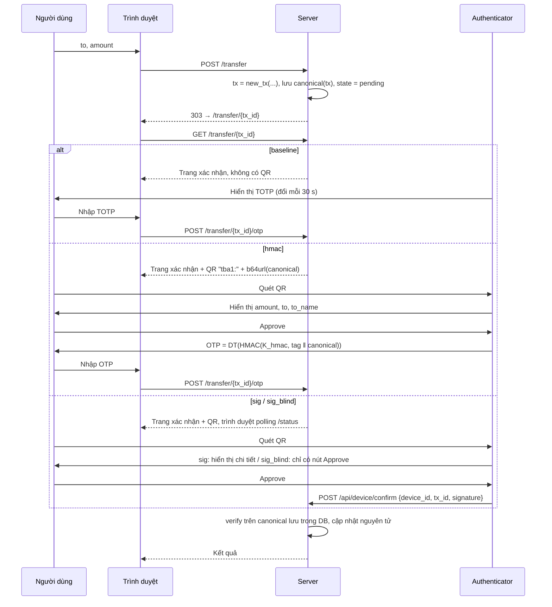
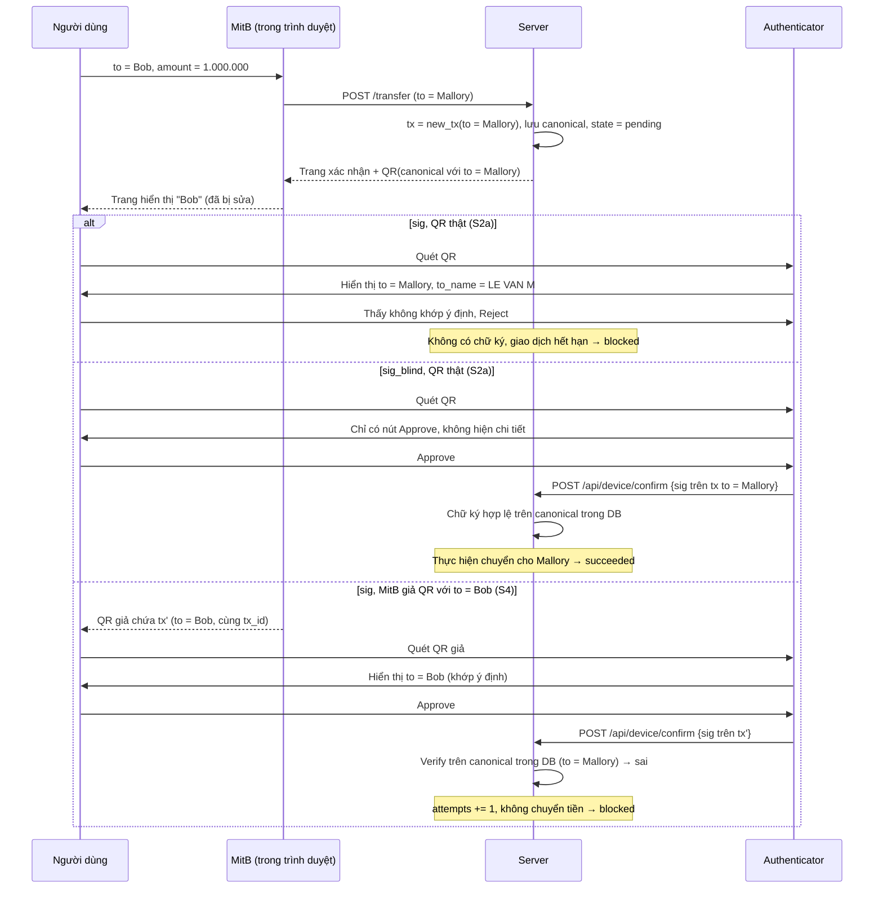
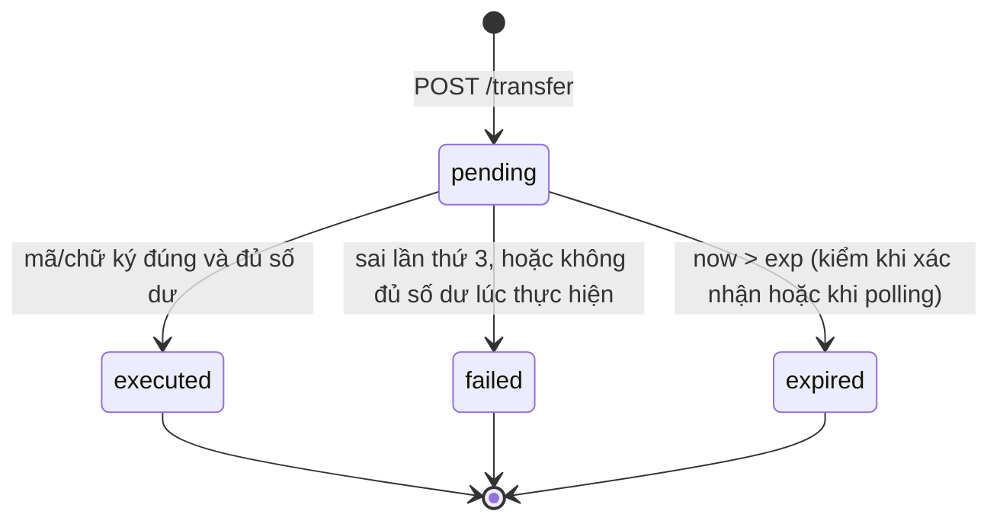
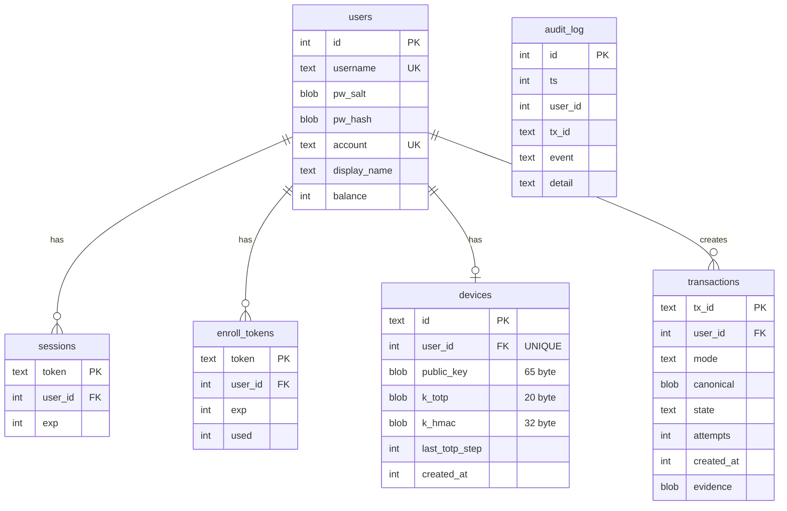

# Architecture: TBA Bank Demo

Tài liệu đi kèm spec `docs/superpowers/specs/2026-11-06-tba-midterm-design.md`. Các sơ đồ viết bằng Mermaid, có thể xuất ra SVG/PDF để đưa vào report (Hình F1-F3).

## 1. Thành phần và phụ thuộc (Hình F1)



Quy tắc phụ thuộc:
- `tba_core` không phụ thuộc vào bất kỳ thành phần nào khác (chỉ dùng stdlib và `cryptography`).
- `server` dùng `tba_core`; không import `evaluation`.
- `evaluation` dùng `tba_core` và `server` (qua `create_app` và `server.testing`).
- `authenticator` chỉ giao tiếp với server qua HTTP; tính đúng đắn được ràng buộc với Python qua `shared/vectors.json`.
- `attacker/mitb_addon.py` chỉ dùng stdlib (+ `segno` nếu bật giả QR), vì chạy trong môi trường riêng của `mitmproxy`.

## 2. Triển khai khi demo



Server và máy nạn nhân có thể là cùng một laptop. Phương án dự phòng: `cloudflared tunnel --url https://localhost:8443 --no-tls-verify` cho ra một URL có chứng chỉ hợp lệ.

## 3. Đăng ký thiết bị (Hình F2)



Lưu ý khi viết Chương 4 và 5: chỉ khóa riêng ECDSA là không bao giờ rời điện thoại (sinh tại chỗ, `extractable = false`). `k_totp` và `k_hmac` là bí mật dùng chung: server sinh, gửi dạng rõ trong JSON và lưu dạng rõ trong bảng `devices`. "Non-extractable" chỉ đúng với bản sao trên điện thoại *sau khi* `importKey`. Đây cũng là lý do S10 phá được `baseline` và `hmac`. Server hiện sinh và gửi cả hai khóa này ở mọi chế độ, kể cả `sig`/`sig_blind`.

## 4. Xác nhận giao dịch, 4 chế độ (Hình F3)



### 4b. Luồng `sig` khi bị MitB tấn công (hình cho Chương 6)

Người dùng muốn chuyển cho Bob. MitB đổi `to` thành tài khoản Mallory và sửa trang để vẫn hiện Bob. Ba nhánh tương ứng S2a (`sig`), S2a (`sig_blind`) và S4.



Ý chính cho Chương 6: S4 bị chặn nhờ *gắn mật mã* (server chỉ tin bản canonical của mình, G1). S2a chỉ bị chặn khi điện thoại *hiển thị* giao dịch và người dùng đọc nó (G7). `sig_blind` có đủ phần mật mã nhưng vẫn thua S2a.

## 5. Vòng đời giao dịch



Mọi chuyển trạng thái đều nằm trong một `BEGIN IMMEDIATE`. Vì vậy hai yêu cầu đồng thời không thể cùng thấy `pending` (S8).

## 6. Mô hình dữ liệu



## 7. Cấu trúc thư mục

```
.
├── pyproject.toml, Makefile, README.md
├── tba_core/        b64.py encoding.py totp.py hmac_otp.py signature.py challenge.py
├── server/          config.py db.py auth.py transfers.py verify.py app.py main.py testing.py templates/
├── authenticator/   index.html app.css package.json js/{b64,canonical,otp,sig,store,app}.js vendor/jsQR.js tests/
├── attacker/        mitb_addon.py
├── evaluation/      harness.py virtual_phone.py mitb.py user_model.py flows.py scenarios.py expected.py
│                    goals.py latex.py run_scenarios.py bruteforce.py bench.py sizes.py
├── scripts/         gen_vectors.py dev_cert.sh
├── shared/          vectors.json
├── proverif/        (tùy chọn) tba_sig.pv tba_sig_blind.pv
├── tests/           core/ server/ evaluation/
├── results/         (sinh ra bởi make eval)
├── report/          main.tex members.tex chapters/ refs.bib
└── docs/            architecture.md superpowers/{specs,plans}/
```
